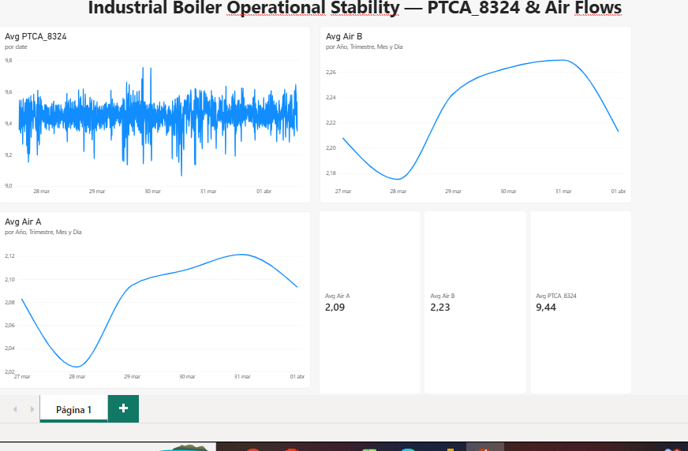

# industrial-boiler-stability-analysis
Project Overview: Industrial Boiler Operational Stability Analysis
Dashboard Title: Industrial Boiler Operational Stability — PTCA_8324 & Air Flows   
Tools & Stack: Python (Pandas, NumPy), Power Query, Power BI Desktop (DAX)Data Source: Time-Series of Industrial Boiler Operations (Kaggle — nikitamanaenkov)
  Analyzed Period: March 27 – April 1   
1. Context & Problem Statement
   In thermal and industrial operations, maintaining the stability of critical combustion and pressure variables is essential to ensure energy efficiency, operational safety, and process continuity. The goal of this project was to build a reproducible pipeline for data extraction, cleaning, statistical process control, and executive visualization to monitor the temporal behavior of an industrial boiler and detect deviations from normal operating bands.
2.  Architecture & Methodology
      Data Processing & Statistical Control in Python:
        Ingested high-frequency time-series data and aggregated it into operational windows (boiler_powerbi_summary.csv).Computed descriptive interval metrics (_prom, _min, _max), rolling standard deviation (_std_movil_prom), and $\pm 3\sigma$ statistical control thresholds for PTCA_8324, airflows AIR_8301A / AIR_8301B, and pressure PT_8313A.
        Data Modeling & Standardization in Power BI:Standardized regional decimal separators and data types in Power Query.Built DAX measures (Avg PTCA_8324, Avg Air A, Avg Air B) to consolidate key performance indicators (KPIs).   Designed an executive dashboard combining high-granularity continuous time series, smoothed daily trends, and baseline KPI cards.
3.  Key Operational Findings
      PTCA_8324 Stability: The variable maintained an overall average of 9.44 throughout the evaluated timeframe, showing continuous oscillations within its normal operating range (approx. 9.10 to 9.75) and a brief episode of higher dispersion around March 30.

    
      Airflow Synchronization (AIR_8301A & AIR_8301B): Both airflow circuits displayed strongly correlated behavior across the week. They reached a minimum dip on March 28, followed by a steady recovery peaking on March 31 and moderating on April 1.   Baseline Supply Levels: Average airflow settled at 2.09 for AIR_8301A and 2.23 for AIR_8301B, reflecting a consistent balance between both air supply lines.
5.  Business & Technical ValueEnd-to-End Technical Traceability: Clean integration between exploratory/statistical modeling in Python and interactive BI reporting in Power BI.Preventive Monitoring: Enables visual detection of regime shifts, airflow asymmetries, and dispersion spikes before they escalate into unplanned downtime or thermal efficiency losses.
